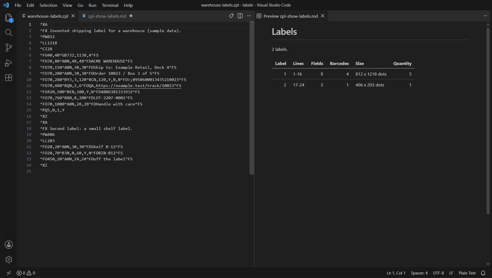
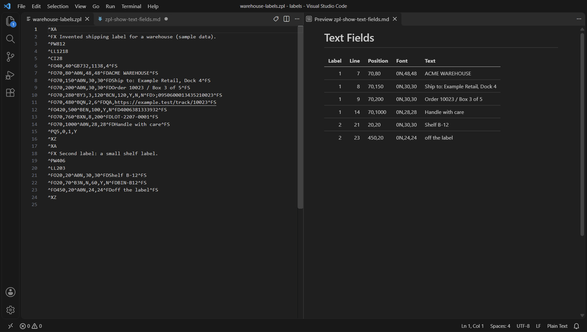
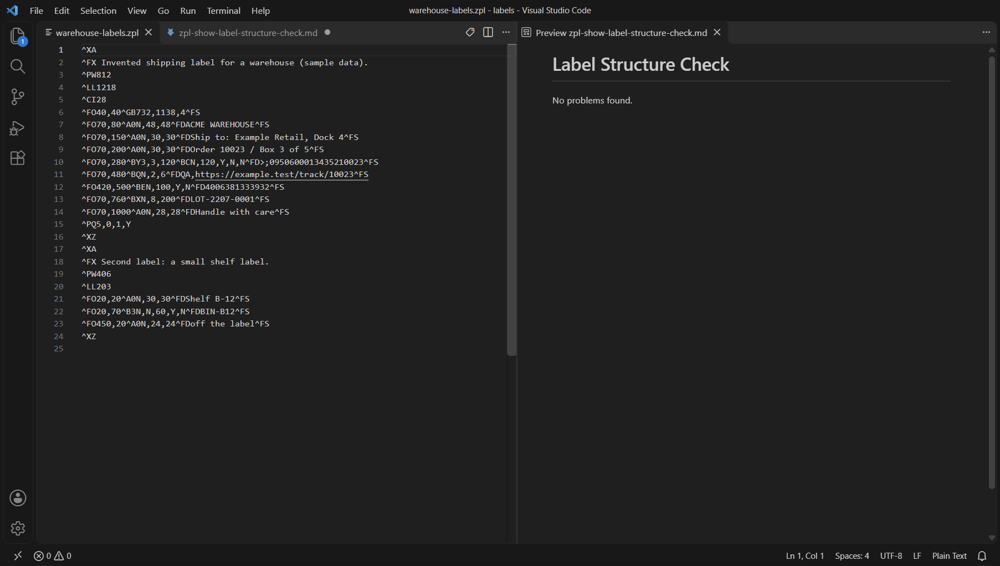
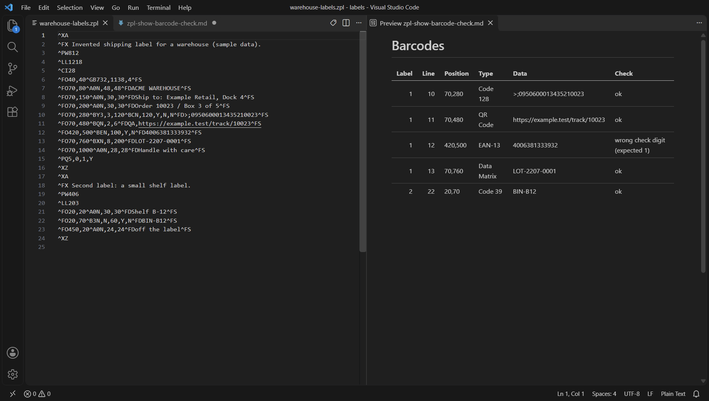
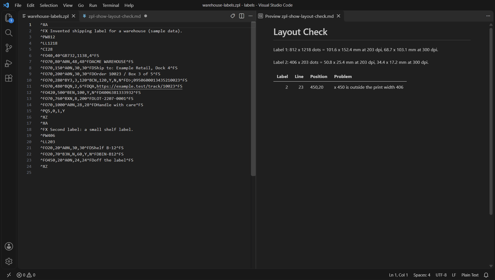

# ZPL Atlas

ZPL Atlas reads ZPL label files and turns them into clear Markdown reports: every label with its size, fields, barcodes and quantity, every text field with its position and font, structure problems such as a label without ^XZ or field data without ^FS, every barcode with its type and data and a check of its check digit, and the label size in millimetres at 203 and 300 dpi with the fields that fall outside the print area.

Everything runs on your computer. There is no telemetry. The only network request the extension ever makes is the licence check for the optional Pro tier (see [Privacy](PRIVACY.md)).

## What it does

* **Show Labels**: Every label with its lines, number of fields and barcodes, size in dots and print quantity.
* **Show Text Fields**: Every text field with its line, position, font and text.
* **Show Label Structure Check**: Structure problems: labels without ^XZ, ^XZ without ^XA, field data without ^FS, commands outside a label.
* **Show Barcode Check** (Pro): Every barcode with its type, position and data, and a check of its check digit or format.
* **Show Layout Check** (Pro): The label size in millimetres at 203 and 300 dpi, and the fields that fall outside the print area.

## Free, trial and Pro

| Feature | Free | Pro |
| --- | :---: | :---: |
| Show Labels | yes | yes |
| Show Text Fields | yes | yes |
| Show Label Structure Check | yes | yes |
| Show Barcode Check |  | yes |
| Show Layout Check |  | yes |
| Open Sample File, walkthrough, Report A Problem | yes | yes |

The free reports need no key, no account and no network connection, and they will not be moved behind the licence key later. The first Pro command starts a **free 14-day trial** on this computer. After that, Pro is a one-time purchase, not a subscription: **Pro Personal USD 19** (one person, use at work allowed) or **Pro Business USD 39 per user** (one key per user of an organisation). A key works on up to 3 computers. The checkout page shows the final price and any taxes for your country. Licence keys are sold by Dodo Payments, the merchant of record. Details: [licence](docs/licence.md), [terms](TERMS.md).

## Commands

Open the Command Palette and type `ZPL Atlas`.

| Command | Tier |
| --- | :---: |
| ZPL Atlas: Show Labels | Free |
| ZPL Atlas: Show Text Fields | Free |
| ZPL Atlas: Show Label Structure Check | Free |
| ZPL Atlas: Show Barcode Check | Pro |
| ZPL Atlas: Show Layout Check | Pro |
| ZPL Atlas: Open Sample File | Free |
| ZPL Atlas: Open Walkthrough | Free |
| ZPL Atlas: Show Documentation | Free |
| ZPL Atlas: Report A Problem | Free |
| ZPL Atlas: Buy Pro | Free |
| ZPL Atlas: Enter Licence Key | Free |
| ZPL Atlas: Show Licence Status | Free |
| ZPL Atlas: Remove Licence From This Machine | Free |

## Settings

| Setting | Default | Meaning |
| --- | --- | --- |
| `zplAtlas.maxFileSizeMB` | 50 | Largest file a report reads (0.1 to 50 MB; VS Code passes files only up to 50 MB to extensions). |
| `zplAtlas.openReportsAsPreview` | true | Open each report in the Markdown preview as well. |

## FAQ

**Does ZPL Atlas send my labels anywhere?**
No. Every report is created on your computer from the text in the editor, and nothing is sent to a printer or a web service.

**Does it draw a preview of the label?**
No. It lists what each label contains and checks it: structure, barcode data and check digits, and whether fields fall outside the print area. Print a test label to see the final look.

**Which barcodes does it know?**
All barcode commands of ZPL II, from Code 128, Code 39, EAN-13, EAN-8, UPC-A and Interleaved 2 of 5 to QR Code, Data Matrix, PDF417, MaxiCode, Aztec and GS1 DataBar. Check digits are verified for EAN-13, EAN-8 and UPC-A, and QR Code data is checked for its error-correction prefix.

**Why do sizes appear at 203 and 300 dpi?**
ZPL positions and sizes are in printer dots, so the same label is a different size on a 203 dpi and a 300 dpi printer. The layout check shows both, so you can see which printer a label was written for.

## For IT and procurement

* Publisher: SmallStepsStudio (Visual Studio Marketplace), smallstepsstudio (Open VSX).
* Network: one host, `live.dodopayments.com`, for the licence check only, and only after a key is entered. No telemetry. The trial uses no network.
* Files are read from the editor only; the extension writes no files and changes none.
* Source: <https://github.com/small-steps-studio/zpl-atlas>.
* Licence agreement: [LICENSE.txt](LICENSE.txt). Terms: [TERMS.md](TERMS.md). Privacy: [PRIVACY.md](PRIVACY.md).

## Support

Run **ZPL Atlas: Report A Problem** or open an issue at <https://github.com/small-steps-studio/zpl-atlas/issues>. Never post a licence key or confidential data in a public issue.

ZPL and ZPL II are trademarks of Zebra Technologies Corporation; ZPL Atlas is an independent product and is not affiliated with or endorsed by Zebra Technologies.
